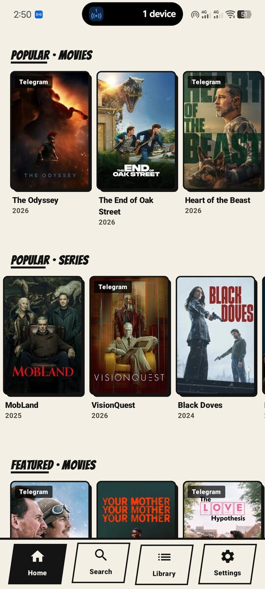
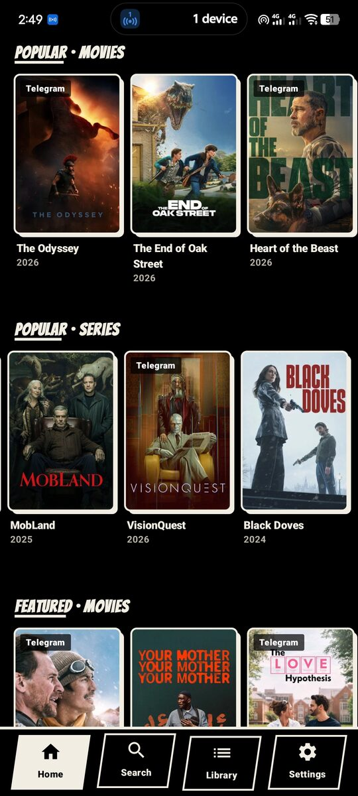
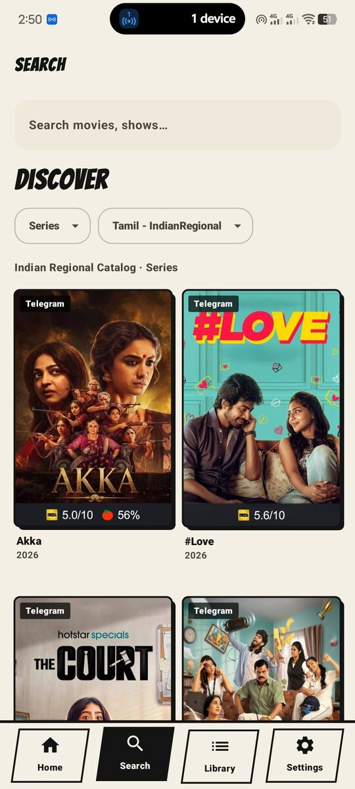
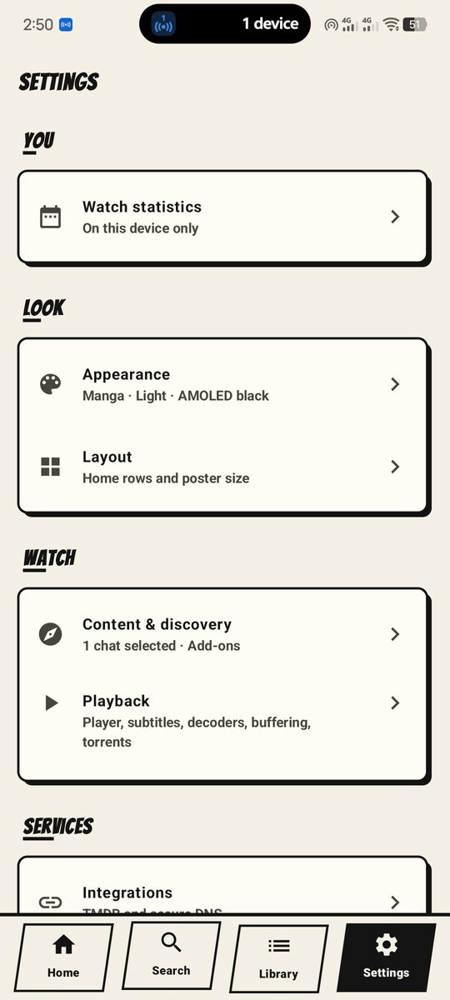
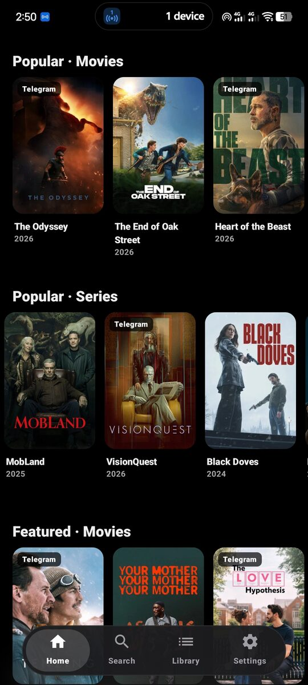
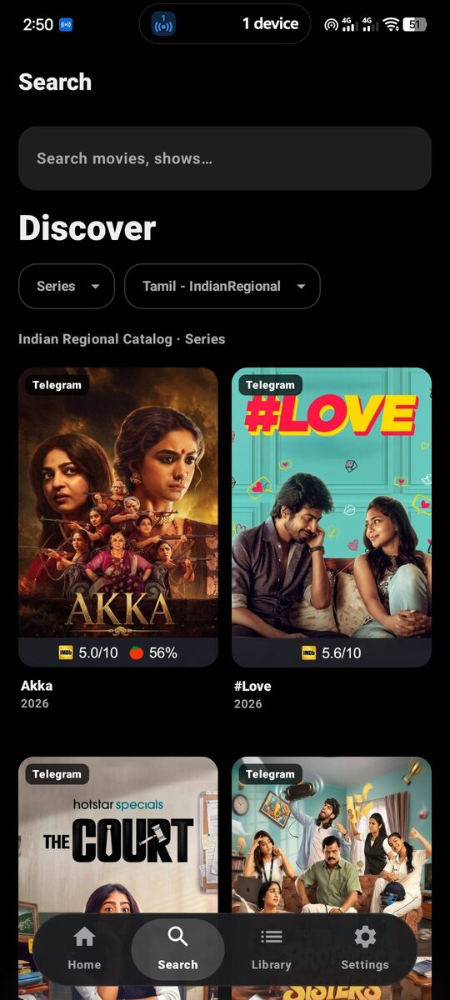
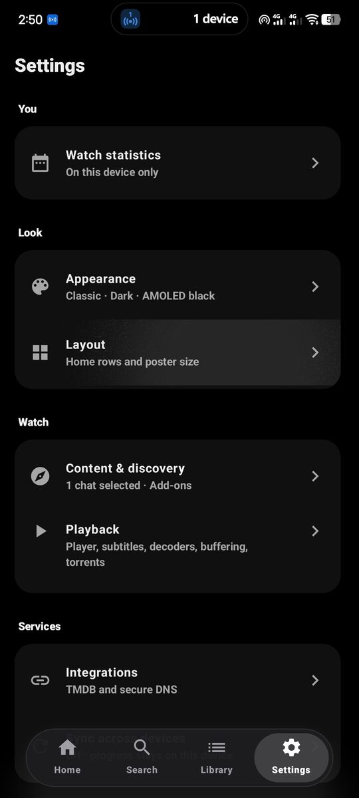
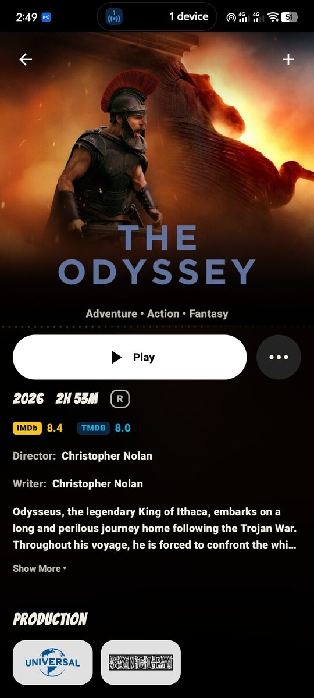
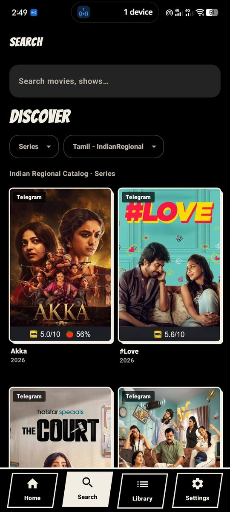
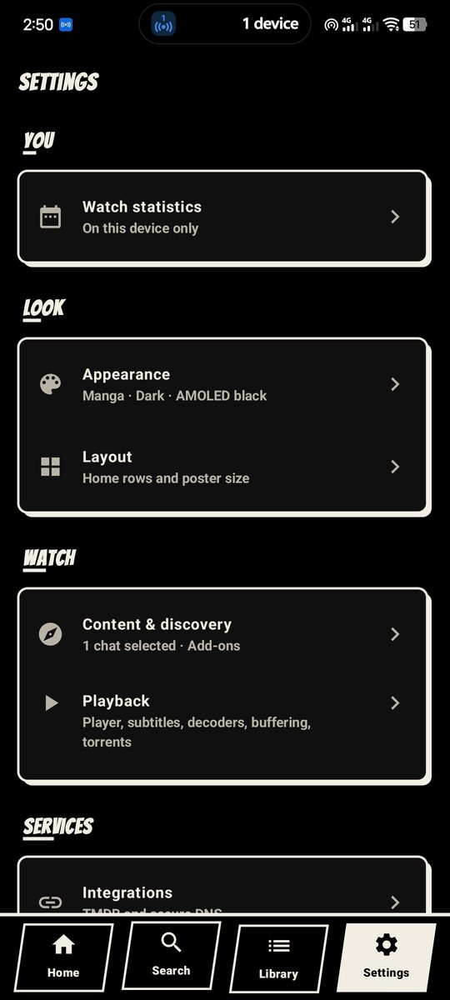

<div align="center">

# 🎬 YourStream

**Your Telegram videos and the files on your phone, as one private movie & series library.**

Posters, episodes, resume and smart playback, streamed straight from Telegram. No uploads, no tracking.

[](https://github.com/Deepakraj1207/yourstream/releases/latest)
[](https://github.com/Deepakraj1207/yourstream/actions/workflows/ci.yml)
[](https://github.com/Deepakraj1207/yourstream/releases)
[](LICENSE)


[📥 Download](https://github.com/Deepakraj1207/yourstream/releases/latest) ·
[✨ Features](#-features) ·
[📸 Screenshots](#-screenshots) ·
[🔒 Privacy](#-privacy) ·
[🛠️ Build](#️-build-from-source) ·
[📚 Docs](#-documentation)

</div>

---

## 📸 Screenshots

<div align="center">

**🌸 Manga style**

| Home (light) | Home (dark) | Discover | Settings |
|:---:|:---:|:---:|:---:|
|  |  |  |  |

**🎬 Classic style & title page**

| Home | Discover | Settings | Title page |
|:---:|:---:|:---:|:---:|
|  |  |  |  |

<details>
<summary>More: manga style, dark</summary>
<br/>

| Discover | Settings |
|:---:|:---:|
|  |  |

</details>

<sub>Real screenshots from a phone running YourStream. The <b>Telegram</b> badge on a poster means that title can be played from your own Telegram chats.</sub>

</div>

---

## ✨ Features

### 📚 A real library from your Telegram chats
- 🔑 **Sign in with your own Telegram account**: phone number and code, or a QR code from Telegram on another device.
- 📂 **Pick the channels, groups or chats** that hold your videos; YourStream indexes them in the background.
- 🚀 **Fast indexing, even for channels with 100,000+ files**: big channels are read in parallel slices, and when Telegram says "too fast" the indexer slows down by itself and speeds up again later.
- 🎞️ **Movies and series → seasons → episodes**, several versions of one title, duplicates recognised.
- 🧠 **Smart file-name parsing**: titles, years, episodes, languages, quality, even from messy names like `@Channel_LinkZ_Movie_2023_1080p_Tam_+_Tel.mkv`.
- ⏸️ **Indexing you control**: pause, resume, stop; Wi-Fi only; waits when the battery is low.

### 📱 Files on this device
- 📁 **Add folders** from your phone (no permission needed: only the folder you pick), or all videos on the device.
- 🔗 The same film on Telegram and on your phone becomes **one title with two versions**.

### 🖼️ One poster per title, a page like a streaming app
- 🏷️ **One poster per movie or series**: your Telegram files show up as a stream source on it, marked with a **Telegram** badge, not as a separate copy.
- 🎨 Posters, plots and ratings from **TMDB** or **Cinemeta**, matched from the title and year in the file name.
- 📄 **Title page from TMDB** (with your own free API key): logo, backdrop, genres, runtime, certification, **IMDb and TMDB ratings**, director and writers, cast, trailers, production companies and recommendations.
- ✅ A **review screen** for unsure matches, and **Fix match** for anything wrong.

### ▶️ Playback that just works
- ⚡ **Streams while downloading**: seek anywhere without waiting for the whole file.
- 🎬 **4K support**: 4K / 2160p files are recognised from their names and marked with a **4K** badge, you can sort and filter streams by quality (4K / 1080p / 720p / SD) and search for *"… in 4K"*. 4K movies split into pieces to fit Telegram's upload limit (`.mkv.001`, `.002`, …) play as one movie. 4K, HEVC and HDR play when your phone or TV's hardware can decode them.
- 🎚️ **Sort and filter streams** by quality, size or source before you press play.
- 🗣️ **Audio and subtitle languages by preference**, remembered per movie and series; FFmpeg audio for formats your phone lacks.
- 🔒 **Background playback** with lock-screen and headset controls, picture-in-picture, next episode.
- 📥 **Offline downloads**: save a version and watch without a connection.

### 🍿 Watch tracking
- ⏯️ Continue watching, next episode, recently added, favorites, statistics, all computed on the device.
- 🔄 Optional **end-to-end encrypted progress sync** across your devices, stored in your own Saved Messages.

### 🔎 Search and Discover
- 🔍 Offline, fuzzy, transliteration-aware search, plus plain-language questions such as *"Telugu movies I haven't watched"*.
- 🧭 **Discover**: browse add-on catalogs by type and catalog (for example *Series · Tamil – Indian Regional*), with ratings on every poster.

### 🧩 Optional extras
- 🧩 **Stremio-protocol add-ons** (the same kind Nuvio uses) for discovery catalogs and web streams (with resume).
- 🧲 **Torrent streaming**: off by default; turning it on explains that peers see your IP address.

### 🎨 Made to feel good
- 🖌️ **Manga** and **Classic** styles, dark / light / AMOLED black.
- 🎠 A **hero carousel** on Home that opens instantly, kept between tabs instead of reloading.
- 📳 **Haptic feedback** on taps, toggles and long presses (follows your system setting).
- 🧭 Simple navigation: **Home · Search · Library · Settings**.
- 👋 A guided first run, **reduce motion** support, 48 dp touch targets, screen-reader labels.
- 📺 Phone, tablet and **Android TV** layouts with full remote control.

---

## 🔒 Privacy

> [!NOTE]
> Your videos stay where they are: in Telegram or on your device. **Nothing is uploaded. No analytics, no ads.**

| What | Where it goes |
|---|---|
| 🎬 Your videos and messages | Nowhere. Played from Telegram or from your device |
| 🔤 Title + year from a file name | A movie database (TMDB / Cinemeta), to find posters. **Never** message text, chat names or file names |
| 🖼️ Poster requests on blocked networks | Image proxies, **only** if your network blocks the poster server. Can be switched off |
| 🌐 Host names on blocked networks | DNS over HTTPS (Cloudflare / Google), **only** if your network's DNS blocks a site. Can be switched off |
| 👋 Signing out | Removes your account's data from the device |

Full details: [`docs/SECURITY_REVIEW.md`](docs/SECURITY_REVIEW.md).

---

## 📥 Install

1. Open the **[latest release](https://github.com/Deepakraj1207/yourstream/releases/latest)** (Android 8.0 or newer).
2. Download the APK for your device:

   | File | For |
   |---|---|
   | `YourStream-…-arm64-v8a.apk` | 📱 Almost every phone and tablet from recent years |
   | `YourStream-…-armeabi-v7a.apk` | 📺 Older phones, many TV sticks and boxes |
   | `YourStream-…-universal.apk` | 🤷 Any device (bigger). Not sure? Take this one |

3. Open it and allow **"Install unknown apps"** when asked. On a TV: `adb install YourStream-*.apk`.

### 🪟 Windows

Download **`YourStream-…-windows-x64.msi`** from the same release and run it (per-user install,
no administrator rights). It is the first desktop version: sign in, choose chats, browse and play
your library; VLC comes inside the installer. Details and what is not there yet:
[`docs/WINDOWS.md`](docs/WINDOWS.md).

🔄 **Updates come by themselves**: the app downloads only the APK for your device and checks it against the release's checksums before installing.

---

## 🛠️ Build from source

```bash
git clone https://github.com/Deepakraj1207/yourstream.git
cd yourstream
cp secrets.properties.example secrets.properties   # add your Telegram api_id / api_hash from my.telegram.org
./gradlew test :app:assembleDebug
```

📖 Credentials, sign-in and sign-out: [`docs/TELEGRAM_SETUP.md`](docs/TELEGRAM_SETUP.md) · 🚀 Releasing: [`docs/RELEASE.md`](docs/RELEASE.md)

---

## 🧱 Architecture

```text
 ┌──────────────────────────── app ────────────────────────────┐
 │  ui:screens (Compose, Material 3, TV)  ·  ui:core (design)  │
 ├──────────────┬──────────────┬──────────────┬────────────────┤
 │ library      │ playback     │ search       │ watch · sync   │
 │ metadata     │ (Media3,     │ assistant    │ catalog        │
 │ (TMDB, …)    │  torrent)    │              │ (add-ons)      │
 ├──────────────┴──────┬───────┴──────────────┴────────────────┤
 │ media (indexer, file-name parser, local files)              │
 ├─────────────────────┴───────────────────────────────────────┤
 │ telegram (TDLib)  ·  core (Room database, network, common)  │
 └─────────────────────────────────────────────────────────────┘
```

**Stack:** Kotlin · Jetpack Compose (Material 3, Compose for TV) · Hilt · Room · WorkManager · Media3 / ExoPlayer · TDLib · Coil · OkHttp · libtorrent4j · FFmpeg audio decoder.
40 Gradle modules; details in [`docs/ARCHITECTURE.md`](docs/ARCHITECTURE.md).

---

## 🧪 Quality

- ✅ **700+ JVM tests** (Robolectric, real Room databases, Media3 against simulated Telegram files), lint, a debug build and a minified release build on **every push**.
- 🔐 Releases are **signed with one pinned key**, and CI checks every APK's certificate before publishing.
- 📋 What still needs a real phone is listed, with step-by-step checks, in [`docs/IMPLEMENTATION_PROGRESS.md`](docs/IMPLEMENTATION_PROGRESS.md).

---

## 📚 Documentation

| | Topic | Docs |
|:---:|---|---|
| 🗺️ | Plan, status, device checks | [IMPLEMENTATION_PROGRESS](docs/IMPLEMENTATION_PROGRESS.md) · [PRODUCT_AUDIT](docs/PRODUCT_AUDIT.md) |
| 🧱 | Architecture and interfaces | [ARCHITECTURE](docs/ARCHITECTURE.md) · [API](docs/API.md) |
| 🔒 | Security and privacy | [SECURITY_REVIEW](docs/SECURITY_REVIEW.md) |
| 🔑 | Telegram sign-in and sign-out | [TELEGRAM_SETUP](docs/TELEGRAM_SETUP.md) |
| 📂 | Indexing and file names | [INDEXING](docs/INDEXING.md) · [PARSER](docs/PARSER.md) · [LOCAL_MEDIA](docs/LOCAL_MEDIA.md) |
| 🎞️ | Library, metadata, catalogs | [LIBRARY](docs/LIBRARY.md) · [METADATA](docs/METADATA.md) · [CATALOGS](docs/CATALOGS.md) |
| ▶️ | Playback and streams | [PLAYBACK](docs/PLAYBACK.md) · [ADAPTIVE_STREAMING](docs/ADAPTIVE_STREAMING.md) · [TRACKS](docs/TRACKS.md) · [STREAMS](docs/STREAMS.md) |
| 🔎 | Search, assistant, watch | [SEARCH](docs/SEARCH.md) · [ASSISTANT](docs/ASSISTANT.md) · [WATCH](docs/WATCH.md) |
| 🎨 | UI, UX, accessibility | [UI](docs/UI.md) · [UX](docs/UX.md) |
| 🛡️ | Robustness, releases | [ROBUSTNESS](docs/ROBUSTNESS.md) · [RELEASE](docs/RELEASE.md) · [RELEASE_R8](docs/RELEASE_R8.md) |

---

## 🤝 Contributing

Bug reports and pull requests are welcome. 🐞 For a wrong title, please include the **file name**: they become test cases (`media/filename` already has over a hundred real ones). Run `./gradlew test :app:lintDebug` before opening a pull request.

---

## ⚖️ License

YourStream is free software under the **[GNU General Public License v3.0](LICENSE)**. It bundles components under their own licenses (listed in the app under *Settings → About → Open-source licenses*), among them the FFmpeg audio decoder for Media3 (Jellyfin build, GPL-3.0), which is why the app as a whole is GPL-3.0.

> [!IMPORTANT]
> YourStream plays files you already have access to, in your own Telegram account or on your device. It hosts no content. You are responsible for what you watch with it.

<div align="center">

Made with ❤️ and Kotlin · ⭐ Star the repo if YourStream is useful to you

</div>
